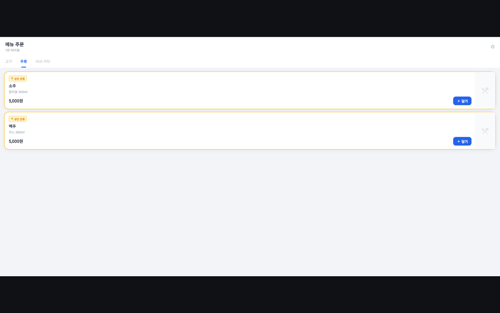
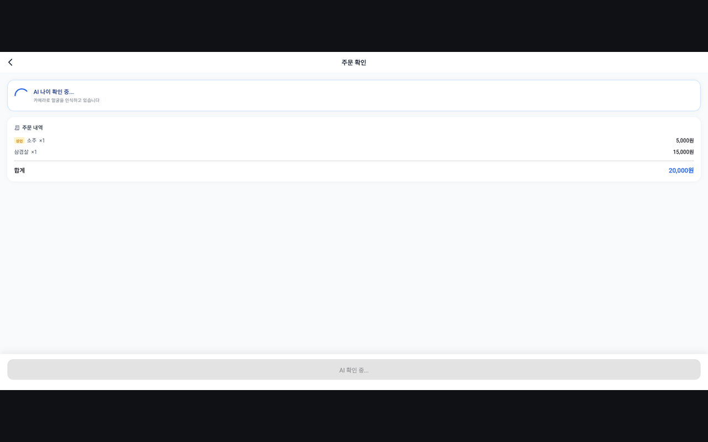
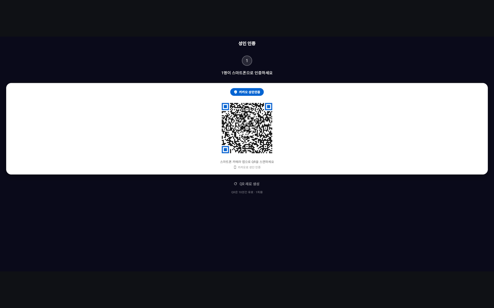
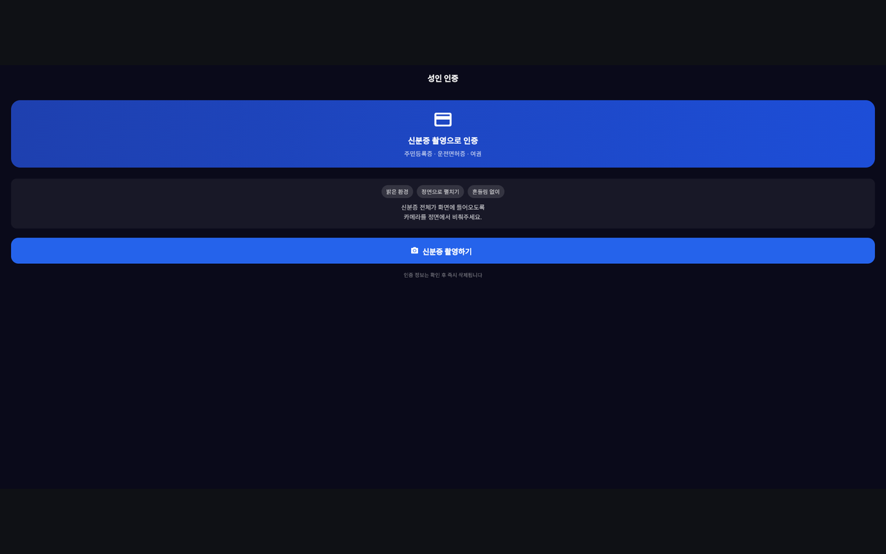

# 🍻 TrueID — 테이블 오더 성인 인증 시스템

> 🏆 2026.07.21 교내 창의아이디어경진대회(2인) **최우수상(1위)**
> 🏅 제20회 서울시 직업계고 창의아이디어 경진대회 **본선 진출**
>
> 식당 테이블의 태블릿에서 주류를 주문하면, 추가 장비나 앱 설치 없이 **그 자리에서 성인 인증**을 끝내는 시스템입니다.

---

## 1. 한 줄 소개

| | |
|---|---|
| 📅 기간 | 2026년 6월 ~ 8월 |
| 👥 인원 | 2명 — 박시우(팀장), 조휘연 |
| 🧑‍💻 내 역할 | **팀장 + 풀스택 개발** (FastAPI 백엔드 + Flutter 앱 전부) |

**내가 맡은 일**

- 팀 전체 일정 관리와 대회 출품 준비를 맡았습니다.
- FastAPI 백엔드를 처음부터 끝까지 만들었습니다. DB 설계, 주문/인증 API, 카카오 OAuth 연동, AI 추론 엔드포인트까지 전부 제가 썼습니다. (Python 약 3,800줄)
- 태블릿에서 돌아가는 Flutter 앱도 제가 직접 만들었습니다. 메뉴·주문·성인인증·주방 화면까지 30개 파일, Dart 약 7,000줄입니다.
- Docker Compose로 DB·API를 한 번에 띄우는 개발 환경과 Alembic 마이그레이션을 구성했습니다.

> 교외 대회에 낼 때는 최시원이 기획·하드웨어 쪽으로 합류해서 3명이 되기도 했습니다. 위 수상은 2인 출품 기준입니다.

---

## 2. 사용 기술

**백엔드**


**AI / 비전**


**프론트엔드 / 외부 연동**


---

## 3. 왜 만들었나

- 테이블 오더가 늘어나면서 **직원이 얼굴을 보지 않고 주류 주문이 그대로 들어가는** 상황이 많아졌습니다. 미성년자가 술을 주문해도 걸러낼 단계가 없습니다.
- 위조 신분증을 못 걸러내면 손님이 아니라 **가게 사장님이 영업정지 같은 행정처분**을 받습니다. 억울한 쪽은 자영업자입니다.
- 키오스크에 신분증 투입구 같은 하드웨어를 다는 해결책은 설치비·유지비가 커서 작은 가게가 쓰기 어렵고, 손님에게 앱 설치나 회원가입을 요구하면 아무도 안 씁니다.

→ 그래서 **가게에 이미 있는 태블릿만으로, 손님이 앉은 자리에서 끝나는 성인 인증**을 만들기로 했습니다.

---

## 4. 어떻게 해결했나

### ① 주류가 담겼을 때만 인증 단계로 보내기

주문을 만들 때 장바구니에 `is_adult_only` 품목이 하나라도 있는지 검사합니다. 없으면 바로 `CONFIRMED`로 확정해서 주방으로 넘기고, 있으면 `PENDING_VERIFY` 상태로 묶어 두고 인증이 끝나야 주방 화면에 뜨게 했습니다.

술을 안 시키는 손님은 평소와 똑같이 주문하고, 술을 시킬 때만 인증 화면을 보게 하는 게 핵심이었습니다.

> `backend/app/api/v1/endpoints/orders.py` · `backend/app/models/order.py`

### ② 카메라로 인원 수와 나이를 먼저 확인

태블릿 카메라 사진을 백엔드로 보내면 두 가지를 봅니다.

- **YOLOv8n** (`/ai/detect-people`) 으로 테이블에 몇 명이 앉아 있는지 세서, 인증이 몇 번 필요한지 정합니다.
- **InsightFace(buffalo_s)** (`/ai/estimate-age`) 로 얼굴 나이를 추정해서, 기준 나이(코드상 만 50세) 이상이면 신분증 인증을 건너뛰게 했습니다. 어르신한테 매번 신분증을 요구하는 게 오히려 불편하다고 생각했습니다.

InsightFace 첫 로드가 느려서 서버가 뜰 때 백그라운드 스레드로 미리 워밍업하도록 했습니다.

> `backend/app/api/v1/endpoints/ai_detect.py` · `backend/app/main.py`

### ③ 인증은 두 갈래 — 휴대폰 또는 실물 신분증

- **모바일**: 태블릿이 1회용 토큰이 담긴 QR을 띄웁니다. 손님이 자기 폰으로 찍으면 서버가 만든 모바일 페이지가 열리고, **카카오 OAuth**로 로그인해서 계정의 생년월일로 성년 여부를 판별합니다. 토큰은 10분 만료 + 1회용이고, 태블릿은 2초마다 폴링해서 인증이 끝난 걸 감지합니다.
- **실물 신분증**: 신분증을 촬영해서 보내면 **EasyOCR**이 주민등록번호 앞자리 / 운전면허번호 / 여권 MRZ에서 생년월일을 뽑아 나이를 계산합니다. 주민번호 뒷자리는 저장하지 않고, 같은 신분증을 돌려쓰지 못하게 해시만 남깁니다.

필요한 인증 횟수를 다 채우면 주문이 `CONFIRMED`로 바뀌고 주방 화면에 올라갑니다.

> `backend/app/api/v1/endpoints/orders.py` · `kakao_auth.py` · `ocr_id.py` · `cert_qr.py`

> **실행 메모** — AI 모델 가중치(`yolov8n.pt`, `best.pt`)는 용량이 커서 레포에 넣지 않았습니다. YOLOv8n 가중치는 [Ultralytics](https://github.com/ultralytics/assets/releases)에서 받아 `backend/` 아래에 두시고, InsightFace·EasyOCR 모델은 첫 실행 때 자동으로 내려받습니다. `backend/.env.example`을 `backend/.env`로 복사한 뒤 `python scripts/gen_secret.py`로 키를 생성하고 `scripts/setup.sh`를 실행하면 DB·API가 함께 뜹니다.

---

## 5. 실행 화면

| | |
|---|---|
|  |  |
| **주류 메뉴 — 성인 전용 표시**<br>주류 탭의 품목에는 `성인 전용` 뱃지가 붙고, 담는 순간 주문이 인증 대상이 됩니다. | **주문 확인 — AI 나이 확인 중**<br>주문 내역을 확인하는 동안 카메라가 얼굴을 잡아 나이를 추정합니다. |
|  |  |
| **모바일 인증 — 카카오 QR**<br>인증이 필요한 인원 수만큼 QR을 띄우고, 손님 휴대폰에서 카카오 로그인으로 성년 여부를 확인합니다. | **실물 신분증 인증**<br>휴대폰이 없거나 카카오 계정이 없는 손님은 신분증을 촬영해 OCR로 인증합니다. |

---

## 6. 어려웠던 점과 해결 과정

**가장 어려웠던 건 기술이 아니라 팀을 끌고 가는 일이었습니다.**

대회가 겹치면서 제출 서류, 발표 자료, 코드가 동시에 굴러갔는데 팀원마다 속도가 달랐습니다. 처음에는 "각자 알아서 하자"고 했다가 마감 직전에 몰아서 하게 됐습니다. 그 뒤로는 제가 **기능 단위로 잘라서 누가 언제까지 무엇을 끝내는지 적어두고**, 막히면 바로 말하게 하는 쪽으로 바꿨습니다. 결국 코드는 제가 대부분 쓰게 됐지만, 그래도 "지금 어디까지 됐는지"를 팀이 같이 보는 게 중요하다는 걸 배웠습니다.

**손님 휴대폰이 태블릿 서버에 접근하지 못하는 문제**

QR을 찍으면 손님 폰이 백엔드의 인증 페이지를 열어야 하는데, 개발 환경에서는 서버가 `localhost`라서 폰에서 열리지 않았습니다. 그래서 QR에 넣을 주소를 하드코딩하지 않고, **태블릿이 자기가 아는 접속 주소(`base_url`)를 서버에 같이 넘기면 그 주소로 링크를 만들도록** 바꿨습니다. 그것도 안 되면 서버가 자기 로컬 IP를 찾아 쓰게 해 뒀습니다. 카카오 OAuth 리다이렉트는 외부에서 접근 가능한 HTTPS 주소가 필요해서 터널로 서버를 밖에 노출시켜 테스트했습니다.

**신분증 OCR이 잘 안 읽히는 문제**

처음에는 EasyOCR에 사진을 그대로 넣었는데 조명이 조금만 어두워도 주민번호를 못 읽었습니다. 그래서 **원본과 전처리본(CLAHE 대비 보정 + Otsu 이진화) 두 장을 모두 OCR해서 결과를 합치고**, 신뢰도 0.3 이상인 텍스트만 모아서 패턴 매칭하도록 고쳤습니다. 주민번호 → 운전면허번호 → 여권 MRZ 순으로 차례대로 시도합니다.

---

## 7. 배운 점 / 다음에 개선할 점

**배운 점**

- 계속 팀장과 회장을 맡다 보니, 리더가 할 일은 제일 많이 코딩하는 게 아니라 **남은 일을 보이게 만들고 막힌 사람을 빨리 찾아내는 것**이라는 걸 배웠습니다.
- 백엔드만 하려다 앱까지 직접 만들게 되면서, API를 설계할 때 **그걸 쓰는 화면 입장에서 생각하는 습관**이 생겼습니다. 인증 상태를 폴링으로 풀어낸 것도 앱 쪽을 만들어 보고 나서 정한 구조입니다.
- 개인정보를 다루는 기능은 "되게 만드는 것"보다 **무엇을 저장하지 않을지 정하는 게 먼저**라는 걸 알게 됐습니다. 주민번호 뒷자리를 저장하지 않고 해시만 남긴 것도 그래서입니다.

**개선할 점** — 코드를 다시 읽으면서 찾은 제 프로젝트의 약점입니다.

- **인증이 없는 API가 너무 많습니다.** 주문 생성과 성인 인증 엔드포인트가 전부 공개라서, 매장 ID만 알면 외부에서 아무나 주문을 만들거나 인증 횟수를 올릴 수 있습니다. 단말기 토큰 발급을 먼저 넣었어야 했습니다.
- **CORS가 `allow_origins=["*"]`** 로 열려 있습니다. 개발 편의로 열어둔 걸 끝까지 안 닫았습니다.
- **성인 인증 QR 서명 키에 기본값이 박혀 있었습니다.** 환경변수를 설정하지 않은 서버끼리 같은 키로 서명하게 되어 QR을 위조할 수 있었습니다. 지금은 기본값을 없애고 키가 없으면 바로 에러를 내도록 고쳤습니다.
- **쓰지 않는 코드가 남아 있습니다.** 지문·얼굴 생체인증(`biometric/`)과 신분증 위변조 판별(`id_verification/`), 커스텀 모델 로더는 작성만 해두고 라우터에 연결하지 못했습니다. 기획 단계에서 넣기로 한 기능을 끝까지 못 간 부분이라, 다음에는 **할 수 있는 범위를 먼저 정하고 시작**하려 합니다.
- **AI 면제 기준이 문서와 코드가 다릅니다.** 제안서에는 "40대 이상 면제"라고 썼는데 실제 코드는 만 50세입니다. 기준 값을 설정으로 빼서 한 곳에서 관리해야 합니다.
- **성능을 측정해 보지 않았습니다.** 추론 속도나 인식률을 눈대중으로만 봤고 벤치마크를 남기지 않았습니다. 다음 프로젝트에서는 숫자로 남겨두려고 합니다.

---

## 폴더 구조

```
backend/              FastAPI 서버
├── app/api/v1/endpoints/   주문·메뉴·매장·인증·AI 엔드포인트
├── app/models/             User, Merchant, MenuItem, TableOrder,
│                           OrderVerification, MobileVerifyToken
├── app/services/           신분증 분석 / 생체인증 모듈 (미연결)
└── alembic/                DB 마이그레이션
table-order-app/      Flutter 태블릿 앱 (고객 / 매장 / 주방 화면)
ai/                   신분증 위변조 분류기 학습 스크립트
scripts/              환경 설정 · 시크릿 생성 스크립트
docker-compose.yml    PostgreSQL + Redis + API
```
